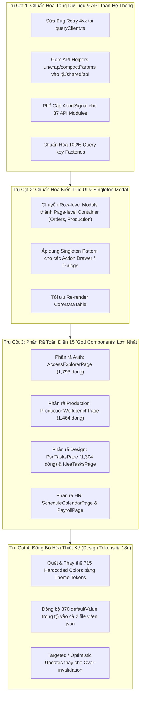

# Báo Cáo Kiểm Tra Toàn Diện & Kế Hoạch Tái Cấu Trúc Toàn Bộ Hệ Thống Frontend

## (System-Wide Frontend Audit & Universal Refactoring Master Plan)

> **Phạm vi:** Toàn bộ 10 Feature Domains (`auth`, `hr`, `portal` [19 submodules], `foundation`, `monitoring`, `system`, `organization`, `audit`, `notifications`, `integration`) và tầng dùng chung (`src/shared`, `src/app`).
> **Ngày lập:** 21/11/2026  
> **Mục tiêu:** Đồng bộ hóa tiêu chuẩn kiến trúc, xóa bỏ nợ kỹ thuật (technical debt), giải quyết triệt để nút thắt hiệu năng (DOM explosion, re-render, over-invalidation), đảm bảo tính nhất quán trên toàn bộ ứng dụng `lng-web-fe`.

---

## I. Tổng Quan Số Liệu Hệ Thống (System-Wide Metrics)

Qua quá trình quét tự động và phân tích tĩnh toàn bộ codebase `src/`:

| Chỉ số kỹ thuật                                       | Số lượng phát hiện                                       | Đánh giá & Rủi ro                                              |
| :---------------------------------------------------- | :------------------------------------------------------- | :------------------------------------------------------------- |
| **Tổng số Module Domain**                             | 10 module chính (28 domain độc lập)                      | Phân tán nhiều cách tiếp cận không đồng bộ                     |
| **Tổng số file `*Api.ts`**                            | 37 files                                                 | 22 files tự định nghĩa lại hàm `unwrap` & `compact`            |
| **Độ phủ `AbortSignal`**                              | **2 / 37 files (5.4%)**                                  | **94.6% API calls không thể hủy khi user gõ search/đổi tab**   |
| **Số file > 500 dòng ("God Components")**             | **42 files** (Top 1 dài 1,793 dòng)                      | Re-render lan rộng, khó bảo trì, vi phạm Single Responsibility |
| **Anti-pattern Mount Modal cấp dòng (Row-level)**     | Xuất hiện tại `orders` (7 modals) & `production`         | **DOM Explosion** (>350 modal instances vô hình trong DOM)     |
| **Vi phạm Query Key Factory (Raw string keys)**       | > 40 vị trí (`['access-accounts']`, `['auth-roles']`...) | Invalidation chệch key, stale cache ngầm, không đồng bộ        |
| **Màu Hardcoded Hex (`#xxxxxx`) vi phạm `DESIGN.md`** | **715 vị trí**                                           | **Vỡ giao diện Dark Mode** (Dual-theme parity không đạt chuẩn) |
| **Lạm dụng `defaultValue` trong `t(...)`**            | **870 vị trí**                                           | Khi đổi sang tiếng Anh vẫn hiển thị fallback tiếng Việt        |
| **Tổng số file Unit & UI Tests**                      | 241 files test                                           | Cần bảo toàn 100% pass khi tái cấu trúc                        |

---

## II. Bảng Đánh Giá Chi Tiết Từng Module (Module-by-Module Audit)

### 1. Domain: Portal - Production & Orders (Khu Vực Vận Hành Tải Trọng Cao)

- **Các file trọng điểm:**
  - `src/features/portal/production/pages/ProductionWorkbenchPage.tsx` (1,464 dòng)
  - `src/features/portal/production/pages/ArtworkInspector.tsx` (830 dòng)
  - `src/features/portal/production/pages/ProductionWorkbenchExpandedRow.tsx` (664 dòng)
  - `src/features/portal/orders/pages/OrderWorkbenchPage.tsx` (672 dòng)
  - `src/features/portal/orders/components/OrderItemPanel.tsx` (715 dòng)
  - `src/features/portal/orders/pages/OrderInlinePanel.tsx` (299 dòng)
- **Vấn đề phát hiện:**
  - **DOM Explosion kép:** Cả `orders` lẫn `production` đều mount Modal trực tiếp trong từng row mở rộng (`ManualSlotUploadModal` trong Production; 7 Modals trong Orders). Với 50-100 task/order trên 1 trang, hàng trăm instance modal được nhồi vào React tree.
  - **Over-invalidation diện rộng:** Mọi mutation (lưu ghi chú, sửa địa chỉ, chuyển trạng thái) đều gọi `queryClient.invalidateQueries` cả bảng, gây giật chớp UI.
  - **Thiếu `AbortSignal` trong Production:** `productionApi.ts` không truyền signal xuống axios, khiến việc lọc theo trạng thái bị lag mạng khi bấm nhanh.

### 2. Domain: Portal - Design, Tasks & Work Scores (`design/`, `team-tasks/`, `work-scores/`)

- **Các file trọng điểm:**
  - `src/features/portal/design/pages/PsdTasksPage.tsx` (1,304 dòng)
  - `src/features/portal/design/pages/IdeaTasksPage.tsx` (859 dòng)
  - `src/features/portal/design/pages/PsdFileWorkspacePage.tsx` (564 dòng)
  - `src/features/portal/work-scores/pages/WorkScoreWorkbenchPage.tsx` (779 dòng)
  - `src/features/portal/work-scores/pages/WorkScoreRuleModal.tsx` (658 dòng)
- **Vấn đề phát hiện:**
  - **Monolithic God Components:** `PsdTasksPage.tsx` chứa toàn bộ từ cấu hình bảng, status formatters, logic upload, history popover đến các modal confirm.
  - **Hardcoded colors & copy:** Chứa nhiều mã màu hex cứng cho status tag (`DATA_COLORS`) và chuỗi i18n fallback tiếng Việt trong JSX.

### 3. Domain: Auth & Access Control (`auth/`)

- **Các file trọng điểm:**
  - `src/features/auth/accounts/pages/AccessExplorerPage.tsx` (**1,793 dòng - File lớn nhất hệ thống**)
  - `src/features/auth/setup/pages/ProfileSetupPage.tsx` (803 dòng)
  - `src/features/auth/access-control/pages/AccessControlPage.tsx` (782 dòng)
  - `src/features/auth/access/pages/AccessEditorPage.tsx` (528 dòng)
- **Vấn đề phát hiện:**
  - **Không đồng nhất Query Keys:** Sử dụng lẫn lộn `authKeys.roles.all()` và raw string `queryClient.invalidateQueries({ queryKey: ['access-accounts'] })` hay `['auth-roles']`.
  - File `AccessExplorerPage.tsx` có quá nhiều modal inline, tab logic, permissions matrix nhồi nhét trong 1 file.

### 4. Domain: HR & Chấm Công / Lương (`hr/`)

- **Các file trọng điểm:**
  - `src/features/hr/pages/ScheduleCalendarPage.tsx` (1,171 dòng)
  - `src/features/hr/pages/PayrollPage.tsx` (1,016 dòng)
  - `src/features/hr/pages/HrOverviewPage.tsx` (1,003 dòng)
  - `src/features/hr/pages/Attendance/AttendancePage.tsx` (690 dòng)
  - `src/features/hr/pages/StaffEditorModal.tsx` (658 dòng)
- **Vấn đề phát hiện:**
  - Tính toán ma trận lịch trực (Calendar Grid) và bảng lương chạy trực tiếp trong body component, gây lag giật khi chuyển tuần/tháng.
  - `hrApi.ts`, `hrOperationsApi.ts`, `hrTimeApi.ts` đều duplicate hàm `unwrap` nội bộ.

### 5. Domain: Portal - Catalog, Vendors & Mapping (`catalog/`, `vendors/`, `mapping/`)

- **Các file trọng điểm:**
  - `src/features/portal/vendors/pages/VendorCostCenterEditorModal.tsx` (923 dòng)
  - `src/features/portal/catalog/pages/CatalogListingWorkbenchPage.tsx` (630 dòng)
  - `src/features/portal/catalog/pages/ProductTypeManagementPage.tsx` (617 dòng)
  - `src/features/portal/mapping/components/RuleEditorPanel.tsx` (576 dòng)
  - `src/features/portal/vendors/pages/VendorIntegrationModal.tsx` (522 dòng)
- **Vấn đề phát hiện:**
  - Form cấu hình Cost Center và Mapping có hàng chục trường động nhưng không dùng Form list tối ưu, gây re-render toàn bộ modal khi gõ 1 input.
  - `mappingApi.ts` và `vendorApi.ts` tự viết lại logic `compact(params)` thay vì dùng helper chung.

### 6. Domain: Portal - Integrations, Reports & Chat (`integrations/`, `reports/`, `chat/`)

- **Các file trọng điểm:**
  - `src/features/portal/integrations/components/ExtensionAutomationTab.tsx` (1,069 dòng)
  - `src/features/portal/reports/pages/ReportOrderCostPage.tsx` (811 dòng)
  - `src/features/portal/chat/pages/ChatWorkspacePage.tsx` (815 dòng)
  - `src/features/portal/reports/pages/ReportWorkspacePage.tsx` (703 dòng)
  - `src/features/portal/chat/components/ChatShell.tsx` (668 dòng)
  - `src/features/portal/integrations/components/TrackingUploadPreviewModal.tsx` (597 dòng)
- **Vấn đề phát hiện:**
  - Báo cáo tài chính và chi phí render các biểu đồ Recharts phức tạp nhưng chưa memoize series data, dẫn đến mỗi lần filter ngày là recalculate lại toàn bộ SVG charts.

### 7. Tầng Dùng Chung (Shared Infrastructure & Core UI)

- **`src/shared/query/queryClient.ts`:**
  - Lỗi logic `axios.isAxiosError` khiến 100% lỗi 4xx bị retry vô nghĩa 2 lần.
- **`src/app/common/CoreDataTable.tsx`:**
  - Duyệt và bọc lại render function của toàn bộ cột qua `useMemo(processedColumns)` và tính toán viewport qua `ResizeObserver`, gây trễ frame khi scroll bảng lớn.

---

## III. Chiến Lược & Lộ Trình Tái Cấu Trúc Toàn Diện (Universal Refactoring Master Roadmap)

Để đồng bộ toàn bộ hệ thống một cách có kiểm soát và an toàn tuyệt đối, dự án sẽ được refactor theo **4 Trụ Cột Đồng Bộ (Architectural Pillars)**:

---

## IV. Chi Tiết Thực Thi Từng Trụ Cột (Execution Specifications)

### Trụ Cột 1: Chuẩn Hóa Tầng Dữ Liệu & API (Data & API Standardization)

1. **Sửa `queryClient.ts`:**
   - Nhận diện đúng `error instanceof ApiError && error.status >= 400 && error.status < 500` để lập tức tắt retry.
2. **Generic API Helpers (`src/shared/api/helpers.ts`):**
   - Export `unwrapResponse<T>(response)` và `compactParams(params)`.
   - Refactor đồng loạt cả **22 files `*Api.ts`**, xóa bỏ toàn bộ mã nội bộ duplicate.
3. **Phổ cập `AbortSignal`:**
   - Cập nhật chữ ký hàm trong tất cả 37 file `*Api.ts` thành `(params, signal?: AbortSignal)`.
   - Cập nhật các custom query hooks để luôn nhận `({ signal }) => apiCall(params, signal)`.
4. **Chuẩn hóa Query Keys:**
   - Xóa bỏ tất cả raw string arrays như `['access-accounts']`, `['auth-roles']` và thay bằng các factory keys: `authKeys`, `accountKeys`, `vendorKeys`.

---

### Trụ Cột 2: Chuẩn Hóa Kiến Trúc UI & Singleton Modal (UI Architecture & DOM Scaling)

1. **Xóa bỏ triệt để Anti-pattern Row-level Modals:**
   - **Orders:** Tạo `OrderActionModalsContainer` ở cấp `OrderWorkbenchPage`, loại bỏ 7 modal trong `OrderInlinePanel`.
   - **Production:** Tạo `ProductionActionModalsContainer` ở cấp `ProductionWorkbenchPage`, loại bỏ `ManualSlotUploadModal` trong `ProductionWorkbenchExpandedRow`.
   - **Vendors:** Tương tự cho các modal edit trong Vendor Table.
2. **Singleton Store Pattern:**
   - Tận dụng Zustand UI stores (`useOrderActionStore`, `useProductionActionStore`) để kích hoạt mở modal theo `activeRecordId` thay vì mount nhiều bản sao.

---

### Trụ Cột 3: Phân Rã Các "God Components" (> 700 dòng)

Tuân thủ nghiêm ngặt cấu trúc của `CONVENTIONS.md`: mỗi màn hình lớn được tách thành 3 thành phần phụ:

- `<Screen>FilterBar.tsx`: Chứa toàn bộ state bộ lọc, search debounce, date picker.
- `<Screen>Columns.tsx`: Định nghĩa bảng, formatters, renderers.
- `<Screen>ActionModals.tsx`: Gom các modal, popover và action forms.
- `<Screen>Page.tsx`: Giữ vai trò Orchestrator mỏng (< 250 dòng).

**Danh sách ưu tiên phân rã đợt 1:**

1. `AccessExplorerPage.tsx` (1,793 dòng) ➔ Tách thành 4 sub-modules.
2. `ProductionWorkbenchPage.tsx` (1,464 dòng) ➔ Tách thành 3 sub-modules.
3. `PsdTasksPage.tsx` (1,304 dòng) ➔ Tách thành 3 sub-modules.
4. `ScheduleCalendarPage.tsx` (1,171 dòng) ➔ Tách Calendar Matrix thành custom hook & component riêng.
5. `ExtensionAutomationTab.tsx` (1,069 dòng) ➔ Tách theo từng channel extension.

---

### Trụ Cột 4: Đồng Bộ Hóa Thiết Kế (Tokens & i18n) & Cache Reactivity

1. **Theme Token Parity (Khử 715 màu hardcoded):**
   - Thay thế các màu hex bằng CSS variables (`var(--ant-color-text-secondary)`, `var(--ant-color-border)`, `var(--ant-color-primary)`) hoặc tokens từ `theme.useToken()`.
   - Đảm bảo toàn bộ bảng, thẻ, tag hiển thị hoàn hảo ở Dark Mode.
2. **i18n Parity (Khử 870 `defaultValue`):**
   - Đưa các chuỗi tiếng Việt hardcoded vào `src/shared/i18n/locales/vi/common.json` và bổ sung bản dịch tiếng Anh tương ứng vào `en/common.json`.
3. **Targeted Cache Updates:**
   - Áp dụng `queryClient.setQueryData` cho các thao tác nhỏ (cập nhật note, chỉnh sửa 1 trường thông tin) để UI phản hồi tức thì với 0ms delay, chấm dứt việc refetch toàn bộ trang.

---

## V. Kế Hoạch Triển Khai Theo Đợt (Phased Execution Schedule)

| Đợt         | Trọng tâm                  | Các module thực thi                                                                     | Thời lượng | Rủi ro                                   |
| :---------- | :------------------------- | :-------------------------------------------------------------------------------------- | :--------- | :--------------------------------------- |
| **Batch 1** | **Nền tảng Core & API**    | `queryClient.ts`, `@/shared/api`, đồng bộ 22 `*Api.ts` & phổ cập `AbortSignal`          | 2 - 3 ngày | Thấp (Có unit test bao bọc)              |
| **Batch 2** | **Xóa bỏ DOM Explosion**   | Tái cấu trúc Singleton Modal cho `Orders`, `Production`, `Vendors`                      | 3 - 4 ngày | Trung bình (Cần test kỹ tương tác UI)    |
| **Batch 3** | **Phân rã God Components** | `AccessExplorerPage`, `PsdTasksPage`, `ProductionWorkbenchPage`, `ScheduleCalendarPage` | 4 - 5 ngày | Trung bình (Tách file, giữ nguyên logic) |
| **Batch 4** | **Đồng bộ Token & i18n**   | Quét sạch 715 hex colors & 870 defaultValues, Targeted Cache Updates                    | 3 - 4 ngày | Thấp (Chủ yếu là styling & text keys)    |
